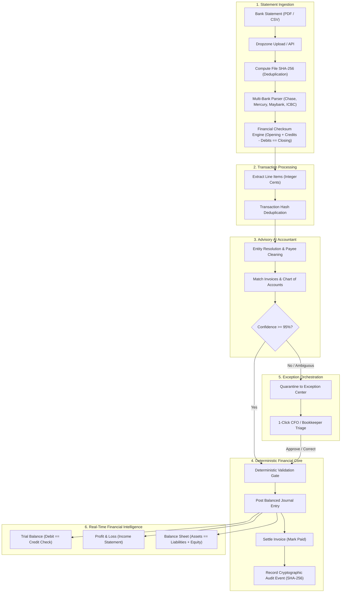

# Agentic Business OS

> Autonomous multi-tenant Agentic Business OS featuring deterministic double-entry accounting, AI exception orchestration, and immutable audit trails.

[](https://github.com/GhulamMustufa/agentic_crm/actions/workflows/ci.yml)
[](https://nodejs.org/)
[](https://www.typescriptlang.org/)
[](<>)

---

## Overview

Agentic Business OS is an enterprise-grade multi-tenant SaaS designed to automate core business operations through deterministic software engines and controlled AI agents. Unlike simple chat assistants, this system executes concrete business workflows with zero direct LLM manipulation of authoritative financial records.

### Core Architecture Directives

1. **Deterministic Authority:** Double-entry general ledger, account balances, monetary arithmetic, and access controls are 100% deterministic and computed on the server.
2. **AI as Untrusted Advisory:** AI output is treated as advisory and staged for human/rules-based approval before ledger mutations occur ([ADR-0004](docs/adr/ADR-0004-ai-agent-staging-and-zero-direct-ledger-mutation.md)).
3. **Multi-Tenant Isolation:** Tenant boundary is strictly enforced via database partitioning, row-level security, and Node.js `AsyncLocalStorage` session context.
4. **Zero Secrets in Source:** Rigorous boundary validation, structured JSON logging with recursive PII/token redaction, and strict `.gitignore` safeguards.

---

## Phase 0: Implemented Foundation

- **Modular Monolith Core:** NestJS modular architecture with explicit layer boundaries ([ADR-0002](docs/adr/ADR-0002-modular-monolith-architecture.md)).
- **Identity & Authentication:** Dual JWT token model (15-min access token + rotating 7-day refresh token with SHA-256 session tracking).
- **Multi-Tenancy & RBAC:** Organization creation, slug collision safety, automated `OWNER` assignment, and granular tenant membership role checks.
- **Cryptographic Audit Trail:** SHA-256 hash-chained immutable audit log with genesis hash chaining and tamper detection.
- **Storage Abstraction:** Pluggable object storage (`LocalStorageDriver` & `S3StorageDriver`) with presigned URL capabilities.
- **Background Jobs:** Worker queue contracts with exponential backoff and dead-letter routing aligned with Transactional Outbox pattern ([ADR-0003](docs/adr/ADR-0003-transactional-outbox-and-bullmq.md)).
- **AI Gateway:** Provider abstraction layer with structured JSON schema output validation and latency simulation.
- **Feature Flags:** Environment defaults and per-tenant dynamic overrides.
- **Database & Migrations:** PostgreSQL 16+ relational schema with foreign key integrity and check constraints.
- **CI/CD Pipeline:** Automated GitHub Actions quality gate enforcing linting, typechecking, tests, format, and production builds.

---

## Phase 1: Accounting Core & Financial Engine

- **Chart of Accounts (COA):** Hierarchical 4-digit standard account codes (Assets 1000s, Liabilities 2000s, Equity 3000s, Revenue 4000s, Expenses 5000s) with system-locked control accounts (AR 1200, AP 2010, Retained Earnings 3999).
- **Fiscal Years & Accounting Periods:** 12-month calendar periods with strict status locking (`OPEN`, `CLOSED`, `LOCKED`). Mutations to closed periods are strictly prevented.
- **Double-Entry Journal Entries:** Immutable posting with strict invariant enforcement ($\sum \text{Debits} == \sum \text{Credits} > 0$). Negative lines and zero-balance entries are rejected at schema and domain boundaries.
- **Account Balances & Rollups:** Real-time period closing balances computed deterministically based on normal balance rules (Debit-normal for Assets/Expenses, Credit-normal for Liabilities/Equity/Revenue).
- **Financial Statements:**
  - **Trial Balance:** Full period balance listing with debit/credit balance verification (`isBalanced: true`).
  - **Profit & Loss (Income Statement):** Period revenue minus operating expenses = Net Income.
  - **Balance Sheet:** Real-time Assets = Liabilities + Equity (including current period Net Income flow into Retained Earnings).
- **Counterparties Directory:** Unified Customers and Vendors directory with normalized name matching to prevent duplicates.
- **Invoicing & Accounts Receivable (AR):** Sales invoices with deterministic line item computation (quantity $\times$ integer cents), sales tax calculation, and automated posting of balanced AR journal entries.
- **Vendor Bills & Accounts Payable (AP):** Expense bill tracking, AP journal entry posting, and payment terms tracking.
- **Payments & Multi-Invoice Allocations:** Inbound customer receipts (Dr Cash, Cr AR) and outbound vendor disbursements (Dr AP, Cr Cash) with partial payment handling and allocation bounds validation.
- **Voiding & Correction Workflows:** Invoices cannot be modified once posted. Voiding posted invoices deterministically posts an inverted reversing journal entry (`REV-...`) with full audit provenance.

---

## Phase 2: Banking Ingestion, Multi-Bank Parsers & Reconciliation

- **Multi-Bank Ingestion:** Native text and layout parsers for major US and international financial institutions (Chase, Silicon Valley Bank, Mercury, Maybank, ICBC).
- **Deterministic Checksum Validation:** Verifies statement running balance arithmetic before any transaction enters the database ($\text{Opening Balance} + \text{Credits} - \text{Debits} == \text{Closing Balance}$).
- **Transaction Line Hashing:** SHA-256 payload hashing prevents duplicate line insertions across overlapping bank statements.
- **AI Payee Cleaner & Entity Resolution:** Normalizes raw bank strings (e.g. `AMZN MKTP US*2K` $\to$ Amazon Marketplace) into clean counterparty entities.
- **Automated Settlement & Reconciliation:** High-confidence transactions ($\ge 95\%$) automatically match open invoices and post balanced ledger entries.
- **Exception Center:** Real-time triage interface for ambiguous transactions, unmapped payees, and discrepancy resolution with bulk cluster actions.

---

## Phase 3: Financial Reporting & Executive Dashboards

- **Trial Balance:** Interactive statement verifying debit/credit equilibrium across all active accounts with period filtering.
- **Profit & Loss (Income Statement):** Real-time revenue vs. expense breakdown calculating Net Operating Income.
- **Balance Sheet:** Verifies the fundamental accounting equation ($\text{Assets} == \text{Liabilities} + \text{Equity}$).
- **Interactive Drill-Downs:** 1-click drill-down from reporting line items to source journal entries and bank transactions.

---

## Phase 4: Modern Dimmed Slate Theme, Resend Email & Onboarding

- **Modern Dimmed Slate Theme:** Optimized dark mode canvas (`oklch(0.21 0.02 255)`) with physical card elevation, high-contrast borders, and anti-glare typography.
- **Resend Email Integration:** Branded transactional email delivery for team invitations and password recovery.
- **Forgot & Reset Password Workflow:** OWASP anti-enumeration safeguards, 32-byte crypto tokens, 1-hour expiration, and complete multi-session revocation.
- **Team Member Invitation System:** Cryptographic token invitation lifecycle (`TenantInvitation` model) supporting both brand-new user registration and 1-click account linking for existing platform users.
- **Dual-Pane Auth Layout:** Enterprise split layout with live mathematical guarantee metrics and security feature highlights.

---

## 🏗️ System Architecture & Data Flow



---

## Project Structure

```
├── .github/workflows/       # CI/CD pipeline definitions
├── docs/                    # Authoritative engineering & architecture standards
│   ├── adr/                 # Architecture Decision Records
│   ├── ARCHITECTURE.md      # Master system design & domain map
│   ├── CODING_STANDARDS.md  # Engineering directives
│   └── DATABASE_SCHEMA.md   # Relational schemas & DDL
├── frontend/                # Next.js 16 App Router application
│   ├── e2e/                 # Playwright end-to-end test suites
│   └── src/app/             # (auth), (dashboard), components, styles
├── src/
│   ├── core/                # Reusable platform primitives
│   │   ├── ai/              # AI provider abstraction gateway
│   │   ├── config/          # Zod-validated environment configuration
│   │   ├── context/         # AsyncLocalStorage tenant context
│   │   ├── email/           # Resend email service & templates
│   │   ├── errors/          # RFC 7807 problem details error handling
│   │   ├── feature-flags/   # Tenant-aware feature toggling
│   │   ├── logging/         # RFC 5424 structured JSON logging with redaction
│   │   ├── queue/           # Background job abstraction
│   │   ├── security/        # JWT auth, password hasher, RBAC guards
│   │   └── storage/         # Pluggable object storage drivers
│   ├── migrations/          # PostgreSQL DDL migrations
│   └── modules/             # Bounded business domains
│       ├── audit/           # Hash-chained immutable audit log
│       ├── banking/         # Bank accounts, statement parsers, reconciliation
│       ├── counterparties/  # Customers, vendors, name normalization
│       ├── exceptions/      # Exception Center & proposal approval
│       ├── identity/        # Users, authentication, session tokens, invitations
│       ├── inventory/       # Inventory items, valuation, movements
│       ├── invoices/        # AR invoices, AP bills, payments, allocations
│       ├── ledger/          # Chart of accounts, periods, journal entries, balances, reports
│       ├── organization/    # Tenants, memberships, organization settings
│       └── payroll/         # Payroll runs, compensation, tax withholdings
└── test/
    ├── integration/         # Supertest end-to-end API integration tests
    └── unit/                # Vitest domain and service unit test suites
```

---

## Getting Started

### Prerequisites

- Node.js >= 20.0.0
- npm >= 10.0.0
- PostgreSQL 16+ (or Neon Serverless Postgres)
- Redis 7+ (optional for local in-memory fallback)

### Installation

```bash
# Clone the repository
git clone https://github.com/GhulamMustufa/agentic_crm.git
cd agentic_crm

# Install backend dependencies
npm ci

# Install frontend dependencies
npm --prefix frontend ci

# Configure environment variables
cp .env.example .env
```

### Database Sync

```bash
# Generate Prisma Client & push schema to PostgreSQL
npx prisma generate
npx prisma db push
```

### Running the System

```bash
# Start backend API (Port 3001)
npm run start:dev

# Start frontend application (Port 3000)
npm --prefix frontend run dev
```

### Quality Gates & Verification

```bash
# Run unit & integration test suites (34 test files, 200+ unit tests)
npm test

# Run strict TypeScript typechecking (Backend & Frontend)
npm run typecheck
npm --prefix frontend run typecheck

# Run static code analysis & linting
npm run lint
npm --prefix frontend run lint

# Run Playwright E2E tests
npm --prefix frontend run test:e2e

# Execute production builds
npm run build
npm --prefix frontend run build
```

---

## Documentation Index

| Topic                                   | Authoritative Document                                                                     |
| :-------------------------------------- | :----------------------------------------------------------------------------------------- |
| **Plain-English Platform Guide**        | [`docs/SYSTEM_ONBOARDING_GUIDE.md`](docs/SYSTEM_ONBOARDING_GUIDE.md)                       |
| **Accounting Codes & Exceptions Guide** | [`docs/ACCOUNTING_CONCEPTS_AND_EXCEPTIONS.md`](docs/ACCOUNTING_CONCEPTS_AND_EXCEPTIONS.md) |
| **System Architecture & Domain Map**    | [`docs/ARCHITECTURE.md`](docs/ARCHITECTURE.md)                                             |
| **Product Vision & Personas**           | [`docs/PRODUCT.md`](docs/PRODUCT.md)                                                       |
| **Master Coding Standards**             | [`docs/CODING_STANDARDS.md`](docs/CODING_STANDARDS.md)                                     |
| **Relational Database Schemas & DDL**   | [`docs/DATABASE_SCHEMA.md`](docs/DATABASE_SCHEMA.md)                                       |
| **REST API Contracts & Idempotency**    | [`docs/API_STANDARDS.md`](docs/API_STANDARDS.md)                                           |
| **Frontend & UI/UX Standards**          | [`docs/FRONTEND_STANDARDS.md`](docs/FRONTEND_STANDARDS.md)                                 |
| **Design System & Theme Tokens**        | [`docs/DESIGN_SYSTEM.md`](docs/DESIGN_SYSTEM.md)                                           |
| **Git Workflow**                        | [`docs/GIT_WORKFLOW.md`](docs/GIT_WORKFLOW.md)                                             |
| **Repository Governance**               | [`AGENTS.md`](AGENTS.md)                                                                   |
